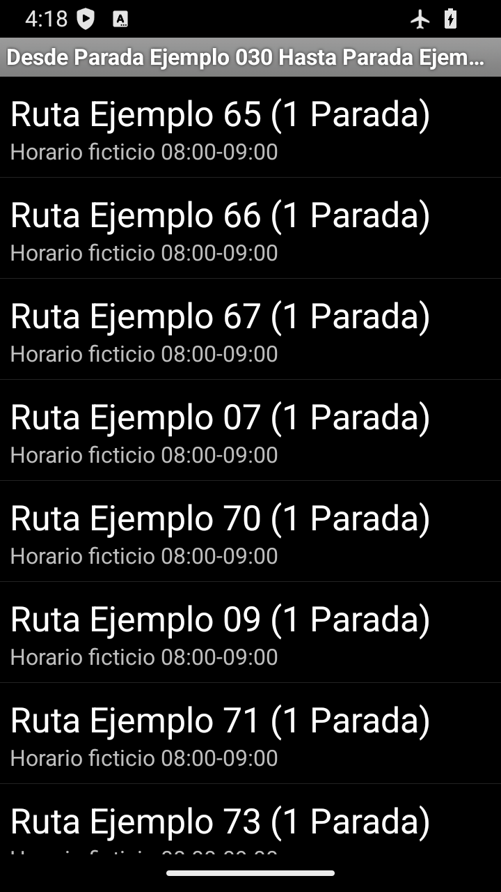
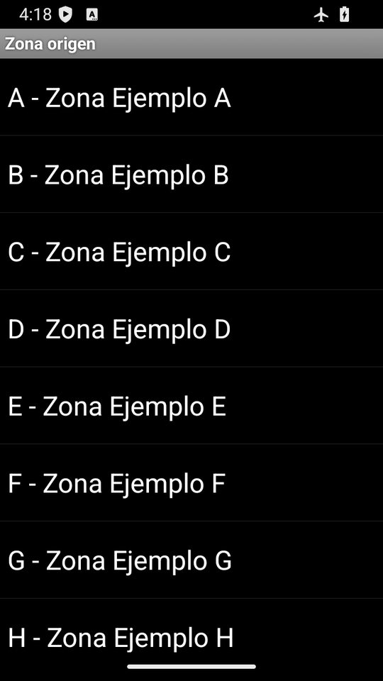
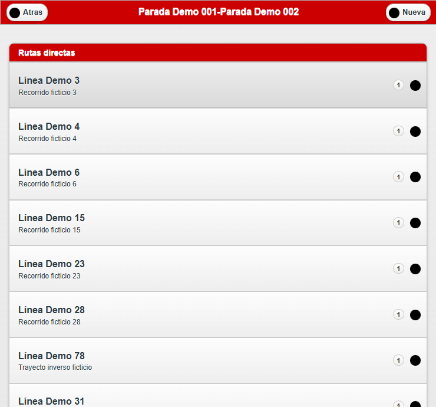
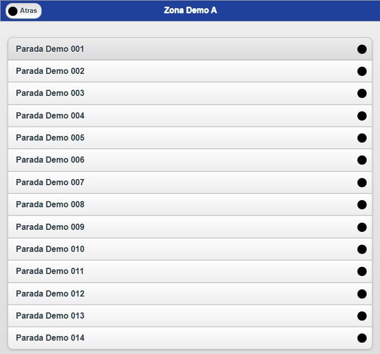
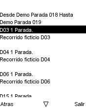
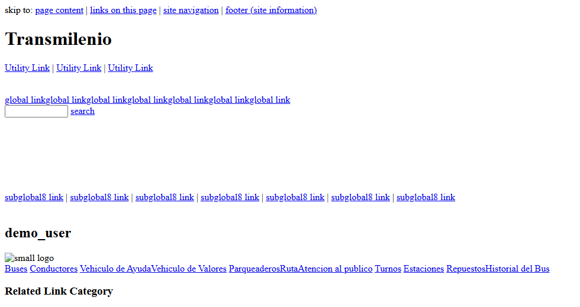

# Transmilleno
[English](#english) · [Español](#español)

## English

Find bus routes in Java ME, Android and the browser, with a PHP panel for managing buses and routes

> [!WARNING]
> **Status: Archived.** The archived editions build with the listed tools. Android Full and Free still have runtime limitations.

### Overview

Mobile route finder and companion bus administration site preserved from the original source.

### Features

- Open the mobile route interface from a Cordova WebView in the Full and Free editions.
- Select stops on a Java ME phone and calculate available connections from the bundled catalogue.
- Maintain buses, stations and routes through the password-protected PHP administration screens.
- Open the desktop or mobile route page selected for the browser.

### Requirements

Python 3.12.4 runs the build script. Build Android with JDK 8u512-b09, JDK 21.0.13+9, Android SDK API 35 and Build Tools 35.0.0. The archived Android JARs required by this edition are in `vendor/android/`. Add MicroEmulator 2.0.4 to the folder passed to `--external` for Java ME. The web build uses Docker with PHP 5.6.40, Docker Engine 29.9.2 and Node.js 24.13.1 for syntax checks. The old administration demonstration uses a disposable MySQL 5.7 service.

### Getting started

Run `python demo/compilar.py --output <new-folder> --jdk8 <jdk8> --jdk21 <jdk21> --sdk <android-sdk> --external <external-jars>` from this checkout. The script builds the editions present in the tree.

### Usage

Open the app, pick the origin zone and stop, choose a destination and read the routes in the results list.

Install a generated Full or Free APK on a test emulator to open its entry page. See the verification limits for this edition.

The administration website under [transmilenio/htdocs/](transmilenio/htdocs/) gives dispatch staff forms for buses, drivers, stops, shifts and maintenance records. The November 2026 revision uses PHP's session array so the protected menu stays open after sign-in. It retains the 2005 website as a separate entry point from the mobile route search.

Run the following commands in PowerShell 7 from the repository root. Docker runs PHP 5.6.40 with the original MySQL extension and MySQL 5.7.44 with a synthetic database. The demo listens on loopback.

~~~powershell
. ./demo/New-WebDemoSecrets.ps1
docker compose -f demo/compose.yaml up -d --build --wait
~~~

Open http://127.0.0.1:33907/ and enter the user *demo_user*. Retrieve this run's password from the same PowerShell session with **$env:TRANSMILLENO_DEMO_LOGIN**. Choose the administration menu after sign-in. When finished, run **docker compose -f demo/compose.yaml down --volumes**.

### Project structure

- `android/`. Android manifests, archived Full and Free activities and the Android viewer resources.
- `demo/`. Build script compilar.py, local database schema and Compose recipe for the PHP administration.
- `docs/`. Real captures of the route viewer and local administration trial under media/.
- `java/`. Java ME route sources. Build the MIDlet via the demo build script.
- `transmilenio/`. The separate 2005 administration site, with htdocs/index.php as entry.
- `vendor/`. Archived Android build inputs and their original notices.
- `web/`. Browser route viewer, styles and data. Open web/web/ to find its plain HTML entry.

### Verification

Built on 20 November 2026 on Windows 10.0.26300 from the August 2012 sources and the documented 2026 updates. Full and Free build. On Android 35 some editions exit during startup and others lack a working local navigation page. In Java ME, MicroEmulator opened the MIDlet lists, accepted both fictional stop selections and displayed route results. The authorized 2026 session fix opened the administration panel using fictional local MySQL records. The browser viewer opened the route list after both fictional stops were selected from its restored local menu.

The following Android Classic demo uses the 2012-09-04 source and a fictional catalogue in a temporary test build.

### History

The archived routes in this working line date to August 2012. The documentation and separate PHP, browser and Android compatibility updates were added in November 2026.

### Support

Reproduce the issue locally and include the edition and its relevant log.

### Contributing

Keep original notices and use fictional examples in any test.

### License

See the [MIT license](LICENSE) and the notices on the dependencies.

---

### Offline browser viewer

From the repository root, start `python -m http.server 8080 --bind 127.0.0.1 --directory web/web`. Open `http://127.0.0.1:8080/m.html`, choose a zone and one of its stops, then repeat for the destination. The restored menu and route engine show fictional direct routes and transfers. The recorded trial used a disposable Python container bound to loopback. The command above reproduces it with Python on your host. Advertising was omitted from this demonstration. Live advertising requires the provider account and was outside the test.

## Español

Consulta rutas de bus en Java ME, Android y el navegador, con un panel PHP para administrar recorridos

> [!WARNING]
> **Estado: Archivado.** Las ediciones archivadas compilan con las herramientas indicadas. Android Full y Free tienen limitaciones de ejecución.

### Descripción general

Consulta móvil de rutas y sitio de administración de buses conservados desde el código original.

### Funciones

- Abre la interfaz móvil de rutas en la vista web de Cordova de las ediciones Full y Free.
- Selecciona paradas en un teléfono Java ME y calcula las conexiones disponibles en el catálogo.
- Gestiona buses, estaciones y rutas desde las pantallas de administración PHP con ingreso de usuario.
- Abre la página de rutas de escritorio o móvil elegida para el navegador.

### Requisitos

Python 3.12.4 ejecuta el script de compilación. Compila Android con JDK 8u512-b09, JDK 21.0.13+9, Android SDK API 35 y Build Tools 35.0.0. Los JAR Android que pide esta edición están en `vendor/android/`. Para Java ME, coloca MicroEmulator 2.0.4 en la carpeta indicada en `--external`. La compilación web comprueba sintaxis con Docker Engine 29.9.2, PHP 5.6.40 y Node.js 24.13.1. La demostración de administración usa MySQL 5.7 desechable.

### Cómo empezar

Ejecuta `python demo/compilar.py --output <new-folder> --jdk8 <jdk8> --jdk21 <jdk21> --sdk <android-sdk> --external <external-jars>` desde esta copia. El script compila las ediciones que están en el árbol.

### Uso

Abre la aplicación, elige la zona y parada de origen, selecciona el destino y consulta la lista de recorridos.

Instala un APK Full o Free en un emulador de prueba para abrir su página inicial. Consulta los límites de verificación de esta edición.

El sitio de [transmilenio/htdocs/](transmilenio/htdocs/) reúne formularios para que el personal de despacho registre buses, conductores, paradas, turnos y mantenimiento. La revisión de noviembre de 2026 usa la sesión de PHP para mantener abierto el menú protegido después del acceso. El sitio de 2005 tiene su propia entrada y se conserva junto al buscador móvil de rutas.

Ejecuta estos comandos en PowerShell 7 desde la raíz. Docker ejecuta PHP 5.6.40 con la extensión MySQL de la época y MySQL 5.7.44 con una base ficticia. La prueba escucha en la interfaz local.

~~~powershell
. ./demo/New-WebDemoSecrets.ps1
docker compose -f demo/compose.yaml up -d --build --wait
~~~

Abre http://127.0.0.1:33907/ y escribe el usuario *demo_user*. Consulta la contraseña de esta prueba con **$env:TRANSMILLENO_DEMO_LOGIN** en la misma sesión de PowerShell. Entra al menú de administración. Al terminar ejecuta **docker compose -f demo/compose.yaml down --volumes**.

### Estructura del proyecto

- `android/`. Manifiestos Android, actividades de Full y Free y recursos del visor Android.
- `demo/`. Script compilar.py, esquema de datos local y receta Compose para la administración PHP.
- `docs/`. Capturas reales del visor de rutas y la prueba de administración local en media/.
- `java/`. Fuentes de rutas Java ME. Compila el MIDlet con el script de demostración.
- `transmilenio/`. Sitio separado de administración de 2005, con htdocs/index.php como entrada.
- `vendor/`. Insumos archivados para compilar Android y sus avisos originales.
- `web/`. Visor de rutas para navegador, estilos y datos. En web/web/ está la entrada HTML.

### Verificación

Compilado el 20 de noviembre de 2026 en Windows 10.0.26300 a partir de las fuentes de agosto de 2012 y los cambios de 2026 documentados para este corte. Full y Free compilan. En Android 35 algunos cortes se cierran al iniciar y otros carecen de una página local que permita recorrer la aplicación. MicroEmulator abrió las listas del MIDlet, recibió las dos paradas ficticias y mostró los recorridos de Java ME. La corrección de sesión autorizada en 2026 abrió el panel de administración con registros ficticios en MySQL local. El visor de navegador mostró resultados tras seleccionar dos paradas ficticias en su menú local restaurado.

La demostración de Android Classic usa el código del 2012-09-04 y un catálogo ficticio en una copia temporal de prueba.

### Historial

Las rutas archivadas de esta línea son de agosto de 2012. La documentación y las actualizaciones separadas de PHP, navegador y Android se agregaron en noviembre de 2026.

### Soporte

Reproduce el problema en local e indica la edición y el registro correspondiente.

### Contribuir

Conserva los avisos originales y usa ejemplos ficticios en las pruebas.

### Licencia

Consulta la [licencia MIT](LICENSE) y los avisos de las dependencias.

### Visor de navegador sin conexión

Desde la raíz ejecuta `python -m http.server 8080 --bind 127.0.0.1 --directory web/web`. Abre `http://127.0.0.1:8080/m.html`, elige una zona y una parada. Repite la selección para el destino. El menú y el motor recuperados muestran rutas directas y transbordos ficticios. La prueba registrada usó un contenedor Python desechable en loopback. El comando anterior permite repetirla con Python en tu equipo. En esta demostración se omitió la publicidad. La publicidad real requiere la cuenta del proveedor y quedó fuera de la prueba.

